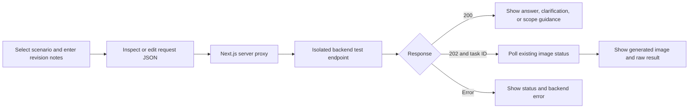

# Next.js enterprise revision test frontend

## Purpose and URLs

The test page in this Next.js application exercises the isolated backend without changing the production generation endpoint. See REVISION-API-TESTING.md for the 16 conditions, expected outcomes, and verification results.

- Frontend page: `http://localhost:3000/enterprise-design/test`
- Backend submission: `POST /api/v1/luna/enterprise-design/test`
- Backend image status: `GET /api/v1/luna/status/{task_id}`
- Same-origin frontend proxies: `/api/enterprise-design-test` and `/api/enterprise-design-test/status?task_id=...`.

These are local URLs. No public deployment or DNS change is included.

## Flow



## Interface

Provide presets for roof advice, supported walkway edit, unclear notes, mixed intent, and a classifier override attempt. Presets fill notes; they do not predetermine classifier results. A scope selector supports front yard, rear yard, whole property, Color & Material, and architectural addition.

The form includes current-design URL, project ID, revision notes, optional reference-image URLs, and an advanced JSON editor for the original brief and other existing enterprise fields. Both singular and plural revision keys are supported by the backend. The structured form uses `revision_comments` by default.

Show HTTP status, response type, confidence percentage, the 70% threshold, unsupported changes, text answer or clarification, and a collapsible raw response. Confidence is a model routing score, not a calibrated probability. Generation responses include task ID, polling status, and an image preview when returned. Text responses never start polling.

## Backend connection

Set server-only environment variables in `.env.local`:

```dotenv
NEXUS_API_ORIGIN=http://127.0.0.1:8000
NEXUS_VENDOR_API_KEY=your-existing-vendor-api-key
```

The origin includes only scheme, host, and optional port. The proxy appends fixed backend paths. Do not use a `NEXT_PUBLIC_` variable for the vendor key. The browser never receives or stores this credential. OpenAI credentials remain in the backend configuration.

Bind the development frontend to loopback. If later hosted, add user authentication before exposing a proxy backed by a shared vendor key. This local test UI is not a public deployment configuration.

## Run and verify

Install dependencies with `npm install`, then run `npm run dev`. Open `http://localhost:3000/enterprise-design/test`. Start/configure the backend separately. Use `node node_modules/typescript/bin/tsc --noEmit --incremental false` and `npm run build` for verification.

Test the following manually with a configured backend:

1. Roof advice: text answer, no image task or polling.
2. Supported edit: HTTP 202 only if classifier confidence qualifies; poll its task.
3. Vague request: clarification, no image task.
4. Mixed request: accepted supported edit only when independent; disclose unsupported changes.
5. Override attempt: clarification when detected, no image task.
6. Invalid payload: show 422 details without retrying submission.
7. Provider unavailable: show 503 without generating an image.
8. Stop polling: cancel the browser's pending polling; do not imply server-side image cancellation.

## Operational behavior

The submission proxy preserves backend response status and JSON, disables caching, and uses a bounded timeout long enough for classifier and answer retries. It does not automatically retry POST requests because an image task may already have been accepted. Poll every three seconds, stop on completion/failure, and stop after a bounded waiting period with a manual resume option. Never classify `submission_unknown` as success; surface it for reconciliation.

Do not render backend answers as HTML. Validate returned image URLs before displaying them. Persist neither entered payloads nor response details to browser storage. Empty notes require the existing original brief; use the advanced JSON editor for those tests.

## Scope of implementation

All frontend source and documentation live in this standalone folder. The backend and existing production pages remain unchanged. Production adoption still requires the ownership, contract, evaluation, and shadow-release gates in `enterprise-design-revision-intent-plan.md`.
